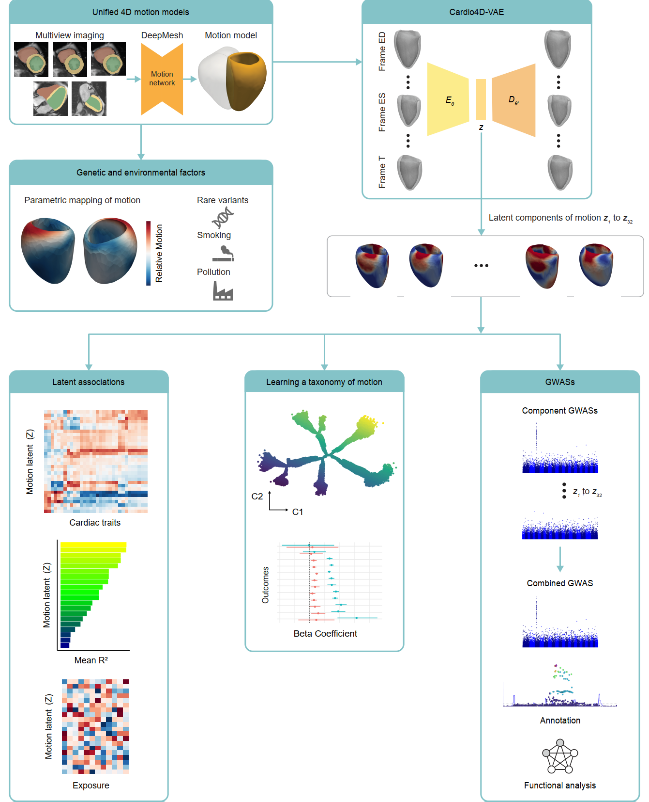

# Population genomics of four-dimensional cardiac motion

This repository contains the code accompanying the paper *"Population genomics of four-dimensional cardiac motion reveals non-myocyte regulatory programmes."*

We apply unsupervised deep learning to four-dimensional cardiac MRI from 78,113 UK Biobank participants to derive latent representations of left ventricular (LV) motion. Our study shows that genome-wide association analysis of these motion traits identifies 39 genetic loci, most of which are not detected by conventional imaging indices. We find that conventional traits map to cardiomyocyte and conduction-system regulatory elements, whereas motion-specific variants converge on non-myocyte programmes in autonomic neuronal, endocardial, fibroblast and endothelial cells. The motion models also show how rare variants and environmental exposures relate to complex spatiotemporal patterns of LV function. Finally, we demonstrate that unsupervised clustering of the latent features yields a taxonomy of cardiac motion, organised as a branching tree of seven phenotypic paths with distinct genetic and clinical risk profiles, which carries prognostic information for major adverse cardiovascular events beyond conventional imaging markers.

---

## Cardio4D-VAE

*Cardio4D-VAE* is a spatiotemporal β-VAE trained on dynamic 3D+t LV mesh sequences (50 frames × 1,200 vertices). It learns a 32-dimensional probabilistic latent representation that captures anatomical shape and temporal deformation throughout the cardiac cycle. The latent features form the basis of all downstream analyses.

---

## Repository structure

| Folder | Description |
|---|---|
| [`cardio4d-VAE`](cardio4d-VAE) | Model, training, inference, quality control and associations with conventional imaging traits |
| [`pca_benchmark`](pca_benchmark) | Linear PCA baseline for comparison with *Cardio4D-VAE* |
| [`genetics`](genetics) | Rare-variant analysis (*TTN*, HCM and DCM P/LP carriers); GWAS and post-GWAS analyses to follow |
| [`exposure`](exposure) | Exposure-wide association study of environmental factors and LV motion |
| [`clustering`](clustering) | Unsupervised tree-based clustering (DDRTree), trait mapping and outcome analysis |

Each folder contains its own README with details.

---

## Downstream analyses

The latent motion features are used for:

- **Genetic association:** GWAS, heritability, fine-mapping, transcriptome-wide association and single-nucleus cell-state enrichment, with external validation in FinnGen, All of Us and GPMap
- **Rare variants:** LV shape and motion in carriers of cardiomyopathy-associated variants
- **Environmental exposures:** associations with smoking, alcohol, diet, air pollution and socioeconomic factors
- **Taxonomy of cardiac motion:** a branching tree of seven phenotypic paths, enriched for variants, risk factors and outcomes
- **Risk stratification:** prognostic value of motion features for major adverse cardiovascular events

---

## Code availability

Scripts for the remaining analyses run on the UK Biobank Research Analysis Platform (RAP), including the GWAS, post-GWAS, single-cell, exposure and clustering analyses, will be released here once access to the RAP is restored, in line with UK Biobank restrictions on individual-level data.

## Data availability

This work uses UK Biobank data, which cannot be shared publicly. Approved researchers can access the data through [application to UK Biobank](https://www.ukbiobank.ac.uk/enable-your-research/apply-for-access).

---

## Citation

If you use this repository, please cite the associated publication (to be added).

---

## Contact

For questions or collaborations, please reach out via GitHub issues or email (s.kalaie@imperial.ac.uk).