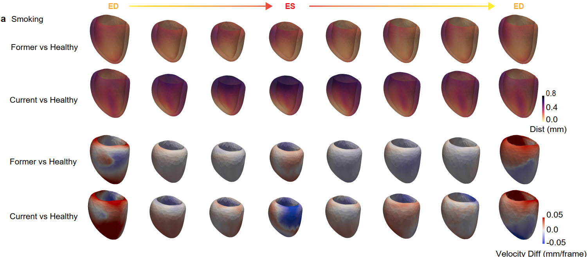

# Environmental exposures and left ventricular motion

This folder contains the exposure-wide association study (XWAS) linking environmental factors to the 32 latent left ventricular (LV) motion features learned by *Cardio4D-VAE* in UK Biobank, together with the 3D visualisation of motion differences between exposure groups.

  

<em>
Mean LV shape and motion across the cardiac cycle (ED → ES → ED) in former and current smokers compared with healthy never-smokers.
Top: distance magnitude (mm). Bottom: signed velocity difference (mm/frame); red indicates faster and blue slower motion than controls.
</em>

## Overview

Exposure extraction and processing follow the exposome framework of [Argentieri et al. (2025)](https://doi.org/10.1038/s41591-024-03483-9). We selected 17 environmental factors related to smoking, alcohol, diet, air pollution and socioeconomic status, all previously associated with cardiovascular disease, giving 25 variables after dummy coding. All exposures were taken from the UK Biobank baseline assessment (instance 0).

## Pipeline

| Step | File | Description |
|---|---|---|
| 0 | `0_Data_extraction.Rmd` | Extract baseline environmental factors from UK Biobank (Spark, RAP) |
| 1 | `1_Exposomes_Preprocess.ipynb` | Recode variables and select exposures (<45% missingness, available across all assessment centres) |
| 2 | `2_Exposome_imputation.ipynb` | Random forest imputation (missRanger) in the full cohort and post-imputation recoding |
| 3 | `3_Motion_XWAS.ipynb` | Covariate-adjusted XWAS across the 32 latent motion features (age at MRI, sex, ethnicity, BSA), with FDR correction and result figures |
| 4 | `exratc_exposome.ipynb` | Define exposure groups for visualisation (smoking status; NO₂ and NOₓ tertiles) |
| 5 | `exposure_visualization.ipynb` | Compute group-mean LV meshes and render distance and velocity difference maps |

Steps 0–3 were run on the [UK Biobank Research Analysis Platform (RAP)](https://ukbiobank.dnanexus.com).

## Code availability

This analysis was performed on individual-level UK Biobank data, which are subject to strict access restrictions. To comply with these restrictions, the code is not yet publicly available. 
