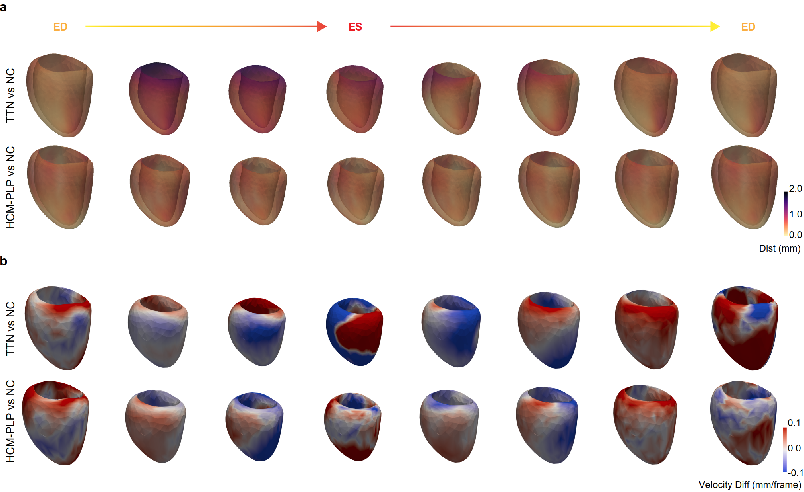

# Genetic Analyses of Cardiac Motion

This folder contains the genetic analyses of the 32 latent left ventricular (LV) motion features learned by *Cardio4D-VAE* in UK Biobank, including the rare-variant analysis of cardiomyopathy-associated genes.

  

<em>
LV shape and motion across the cardiac cycle (ED → ES → ED) in <i>TTN</i> and HCM P/LP variant carriers compared with non-carriers (NC).
<b>a</b>, Distance magnitude (mm). <b>b</b>, Signed velocity difference (mm/frame); red indicates faster and blue slower motion than non-carriers.
</em>

## Code availability

Code for the genetic analyses described in the paper will be released once access to the UK Biobank Research Analysis Platform (RAP) is restored. This includes:

- Genome-wide association studies (REGENIE)
- SNP-based heritability and genetic correlation (LDSC)
- Functional enrichment (S-LDSC) and gene mapping (FUMA, MAGMA)
- Transcriptome-wide association studies (FUSION, GTEx)
- Fine-mapping (SuSiE) and colocalisation
- Single-nucleus cell-state analysis
- (External validation in FinnGen and All of Us)

## Requirements

- Python 3.8
- numpy, pandas, scipy, scikit-learn, matplotlib, pyvista

